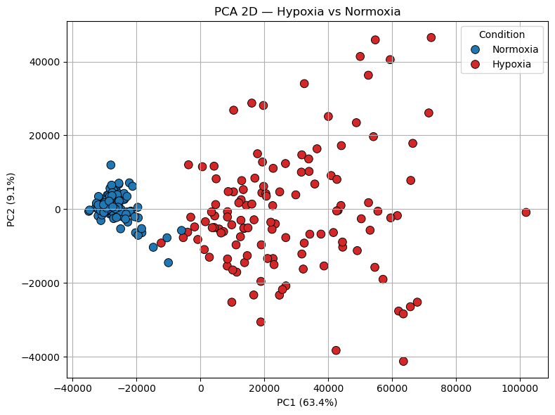

# Hypoxia Classification from Single-Cell RNA-seq

**Can hypoxic and normoxic cancer cells be told apart from their gene expression alone?**

Group project for the *AI Lab* course, Bocconi University (2025). My main responsibility was the unsupervised analysis.

<p align="center">
  
</p>
<p align="center"><sub>MCF7 cells sequenced with Smart-seq, projected on the first two principal components.</sub></p>

## Background

Hypoxia, a shortage of oxygen in the tumour microenvironment, promotes cancer progression and resistance to treatment, so identifying hypoxic cells matters clinically. The data cover two breast-cancer cell lines, **MCF7** (luminal) and **HCC1806** (basal), each sequenced with two single-cell technologies: **Smart-seq** (plate-based, full-length transcripts, a few hundred cells) and **Drop-seq** (droplet-based, roughly 14,000–21,000 cells). Each of the four datasets comes in unfiltered, filtered and normalised versions.

## Analysis

**1. Exploratory analysis.** Sparsity, distribution of counts per cell and per gene, outliers, skewness and kurtosis, log transformation, normalisation and duplicate checks.

**2. Unsupervised learning** (my part). Do the two conditions emerge on their own as clusters?
- Dimensionality reduction with PCA (2D and 3D) and t-SNE.
- Clustering with K-means, agglomerative clustering (single, complete, average and Ward linkage), Gaussian mixtures (four covariance types), DBSCAN and spectral clustering, on the full data and on the PCA projections.
- Evaluation against the true labels with the adjusted Rand index (ARI), silhouette scores and contingency tables.

**3. Supervised learning.** Logistic regression, k-NN, SVM, Random Forest and MLP in leakage-safe pipelines, with 5-fold cross-validation and a hold-out set; Random Forest feature importance to select the 50 most informative genes per dataset; cross-dataset transfer (train on one dataset, test on the others); a pooled classifier on the genes shared by all datasets; and a tuned best-in-class model for each dataset, used to label anonymised external test data.

## Findings

- **Structure is clearest in Smart-seq data.** For MCF7 Smart-seq the two conditions separate along the first principal component, and spectral clustering on two components recovers them with ARI 0.95; K-means, Ward linkage and Gaussian mixtures also align well with the labels. For HCC1806 Smart-seq only spectral clustering recovers them. On the much larger and sparser Drop-seq data, clusters are often geometrically compact (high silhouette) yet mostly unrelated to the conditions (ARI near zero).
- **A few dozen genes suffice.** Within each dataset the best classifiers exceed 95% hold-out accuracy, and restricting them to the top 50 genes preserves or improves performance. The top-ranked genes include canonical hypoxia markers such as *CA9*, *NDRG1*, *BNIP3*, *DDIT4* and *PGK1*.
- **Transfer across domains is harder.** Models trained on one Drop-seq cell line reach only 56–71% accuracy on the other, while a Random Forest trained on a balanced pool of all four datasets, using the 70 genes they share, reaches 87% accuracy (ROC AUC 0.96).

## Repository structure

```
.
├── notebook/
│   └── scrna_hypoxia.ipynb   Exploratory, unsupervised and supervised analysis
├── assets/                   Figures used in this README
└── LICENSE
```

## Data

The datasets are not included in this repository because of sharing restrictions. To run the notebook, place the data files (e.g. `HCC1806_SmartS_Filtered_Data.txt`, `MCF7_SmartS_MetaData.tsv`) in `notebook/`, next to the notebook:

```bash
pip install numpy pandas scipy scikit-learn matplotlib seaborn matplotlib-venn jupyter
cd notebook && jupyter notebook scrna_hypoxia.ipynb
```
